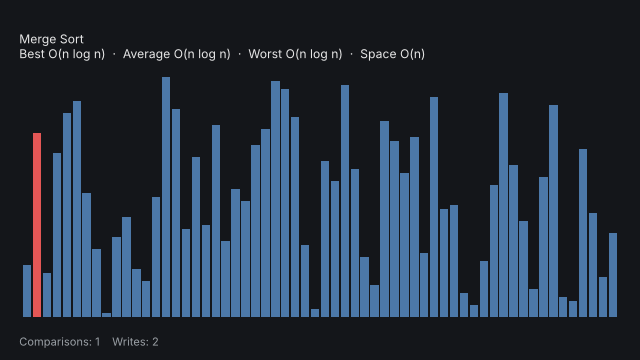

# Sorting Algorithm Visualizer

An interactive sorting algorithm visualizer in Python. Watch six classic algorithms sort bars in real time, compare how many comparisons and writes each needs, and export any run as a GIF.



## Features

- **6 algorithms**: Bubble, Selection, Insertion, Merge, Quick and Heap sort
- **Live controls**: switch algorithm, change array size (5-150) and speed while it runs
- **Live stats**: comparison and write counters, plus best / average / worst time complexity for the selected algorithm
- **Fair comparison**: *Reset* restores the exact same unsorted data so you can run every algorithm on identical input
- **Colour-coded**: yellow = being compared, red = being written, green = sorted
- **GIF export** from the command line (no window needed)
- **Easy to extend**: each algorithm is a ~10-line generator
- Tested (`pytest`), a single dependency (`matplotlib`)

## Quick start

```bash
git clone https://github.com/<your-username>/<your-repo>.git
cd <your-repo>

python -m venv .venv
source .venv/bin/activate        # Windows: .venv\Scripts\activate

pip install -r requirements.txt
python main.py
```

Requires Python 3.9+. Developed and tested on Python 3.13 with matplotlib 3.11.

## Usage

```bash
python main.py                          # open the app (bubble sort, 40 bars)
python main.py -a quick -n 100 -s 5     # quick sort, 100 bars, 5 steps per frame
python main.py -a heap --seed 42        # reproducible shuffle
python main.py --list                   # list algorithms
python main.py -a merge -n 60 --save merge.gif   # export a GIF instead of opening a window
```

| Option | Description | Default |
|---|---|---|
| `-a`, `--algo` | `bubble`, `selection`, `insertion`, `merge`, `quick`, `heap` | `bubble` |
| `-n`, `--size` | Number of bars (5-150) | `40` |
| `-s`, `--speed` | Algorithm steps per animation frame (1-40) | `3` |
| `--seed` | Random seed for a repeatable shuffle | random |
| `--save FILE.gif` | Render a GIF and exit | - |
| `--list` | Print available algorithms | - |

### Controls

| Control | Action |
|---|---|
| **Start / Pause** or `SPACE` | Start, pause and resume |
| **Reset** or `R` | Put the same unsorted data back |
| **Shuffle** or `N` | Generate new random data |
| Algorithm list | Pick an algorithm (resets the run) |
| Size / Speed sliders | Change bar count and animation speed |

## Complexity

| Algorithm | Best | Average | Worst | Space |
|---|---|---|---|---|
| Bubble | O(n) | O(n²) | O(n²) | O(1) |
| Selection | O(n²) | O(n²) | O(n²) | O(1) |
| Insertion | O(n) | O(n²) | O(n²) | O(1) |
| Merge | O(n log n) | O(n log n) | O(n log n) | O(n) |
| Quick | O(n log n) | O(n log n) | O(n²) | O(log n) |
| Heap | O(n log n) | O(n log n) | O(n log n) | O(1) |

## How it works

Every algorithm is a Python **generator** that sorts a list in place and `yield`s after each comparison or write:

```python
def bubble_sort(a):
    for i in range(len(a) - 1):
        for j in range(len(a) - 1 - i):
            yield (j, j + 1), ()              # (indices compared, indices written)
            if a[j] > a[j + 1]:
                a[j], a[j + 1] = a[j + 1], a[j]
                yield (), (j, j + 1)
```

The UI simply calls `next()` on the generator a few times per animation frame and redraws the bars. That keeps the algorithms free of any drawing code.

## Adding your own algorithm

1. Write a generator in `visualizer/algorithms.py` that sorts in place and yields `(compared, written)` tuples.
2. Register it in the `ALGORITHMS` dict (and add its complexity to `COMPLEXITY`).

It appears in the UI, the CLI and the test suite automatically.

## Project structure

```
.
├── main.py                  # CLI entry point
├── visualizer/
│   ├── algorithms.py        # the sorting generators + registry
│   ├── app.py               # interactive matplotlib UI
│   └── export.py            # GIF rendering
├── tests/                   # pytest suite (algorithms + headless GUI)
├── assets/demo.gif
├── requirements.txt
└── LICENSE
```

## Running the tests

```bash
pip install -r requirements-dev.txt
pytest
```

## Troubleshooting

- **No window opens / "FigureCanvasAgg is non-interactive"**: matplotlib needs a GUI backend. Install one, e.g. `pip install PyQt6`, or on Linux `sudo apt install python3-tk`.
- **Animation feels slow with many bars**: raise the *Speed* slider or lower *Size*.

## Ideas for contributions

Shell sort, counting / radix sort, sound effects, different starting patterns (nearly sorted, reversed), or a side-by-side race mode.

## License

MIT - see [LICENSE](LICENSE).
